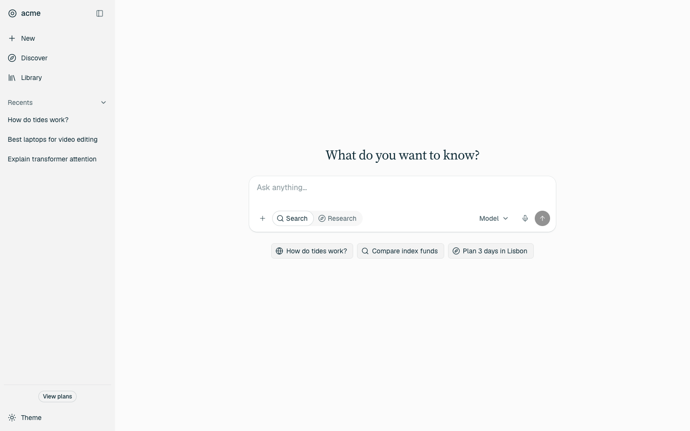
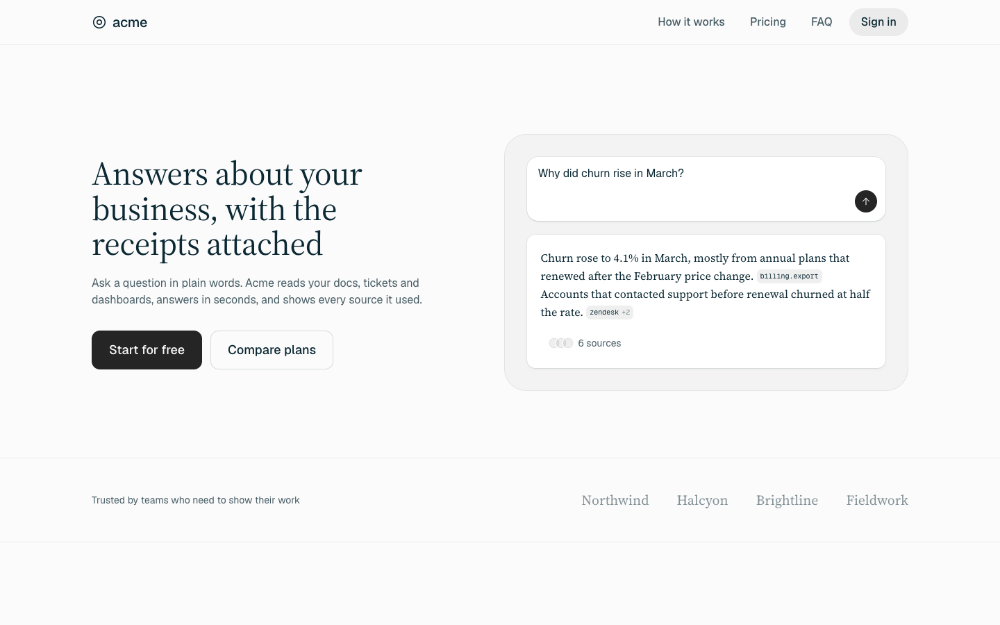
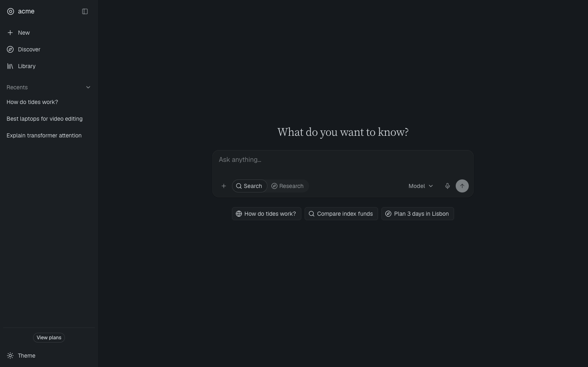

# Perplexity Design

An Agent Skill that teaches coding agents to build interfaces in Perplexity's design language: answer-first layouts, one calm ink colour with a rare teal accent, serif answers with sans chrome, the ask box as the hero, and inline source citations.

The values were measured from perplexity.ai's live CSS (October 2026), not guessed. Every colour and font sits in one BRAND block, so you can keep the discipline and swap in your own brand.



| Landing page | Dark mode |
|---|---|
|  |  |

*Screens built from the skill's own templates, with the placeholder brand "acme".*

## Install

### Any coding agent (Claude Code, Codex, Cursor, Gemini CLI, Copilot, Windsurf, and more)

```bash
npx skills add vidhanm/perplexity-design-skill
```

It asks which agents to install to and whether to install for this project or for your whole machine. To skip the questions:

```bash
npx skills add vidhanm/perplexity-design-skill -g -a claude-code -a codex -a cursor -y
```

Uses the open [skills](https://github.com/vercel-labs/skills) CLI, which supports about 80 agents. Run `npx skills add --help` for the full list.

### Claude Code (as a plugin)

```
/plugin marketplace add vidhanm/perplexity-design-skill
/plugin install perplexity-design@perplexity-design
```

Updates arrive through `/plugin marketplace update`.

### Claude.ai and the Claude desktop app

1. Download `perplexity-design.zip` from the [latest release](https://github.com/vidhanm/perplexity-design-skill/releases/latest).
2. In Claude, open **Settings → Capabilities**, find **Skills**, and upload the zip.
3. Turn the skill on and ask for something "like Perplexity".

Code execution has to be enabled for skills to run.

### By hand

Copy `skills/perplexity-design/` into your agent's skills folder, for example `~/.claude/skills/perplexity-design/` (all projects) or `.claude/skills/perplexity-design/` (one project) for Claude Code.

### Agents without skill support

Point your agent at [`DESIGN.md`](DESIGN.md), a one-file summary of the whole system with the tokens in its front matter. Reference it from `AGENTS.md`, `.cursor/rules`, or paste it into the prompt.

## Use

Once installed, the skill loads on its own when you ask for the look. For example:

- "Build an AI research assistant home screen and answer page. Make it look like Perplexity."
- "Make me a landing page for Ledger that feels like Perplexity's site, not like every other SaaS page."
- "Restyle our settings page in the Perplexity style, using our brand colour #E4572E."
- "Redesign this Next.js app with Tailwind and shadcn so it reads like Perplexity."

It works in plain HTML/CSS, Tailwind v3 and v4, shadcn/ui and Next.js, and has notes for React Native and SwiftUI.

## What's inside

```
skills/perplexity-design/
├── SKILL.md                    the workflow and the rules the agent follows
├── references/
│   ├── app-screens.md          shell, home, answer thread, library, settings, phone, states
│   ├── marketing-pages.md      landing, pricing, product and blog pages
│   ├── components.md           exact sizes, fills and states for every control
│   ├── tokens.md               what each token is for; where the accent may go
│   ├── rebrand.md              applying the system to your own colours and fonts
│   ├── platform-mapping.md     Tailwind, shadcn/ui, Next.js, React Native, SwiftUI
│   ├── voice.md                how the copy should sound
│   └── anti-patterns.md        what makes output look generic, and the fix
├── assets/
│   ├── tokens.css              every colour, font, radius, shadow and timing, light and dark
│   ├── base.css                element defaults and answer typography
│   ├── components.css          reference components
│   ├── tailwind-theme.css      Tailwind v4 theme
│   ├── fonts.md                the open-source font substitutes and how to load them
│   └── templates/              app-shell.html and landing.html
└── scripts/lint.mjs            zero-dependency style checker
```

### The linter

```bash
node skills/perplexity-design/scripts/lint.mjs path/to/your/files
```

It flags colours that aren't tokens, the accent used where it doesn't belong, heavy font weights, decorative effects, emoji, filler copy, a missing dark mode or reduced-motion rule, and brand colours with too little contrast. It needs Node 18 or newer and nothing else.

## Using your own brand

Edit only the BRAND block at the top of `assets/tokens.css`: ink, backgrounds, accent and fonts. Everything else derives from it. `references/rebrand.md` walks through picking each value, and the linter checks the contrast of the result.

## The design in brief

- **One ink, not a ladder of greys.** Text at 100, 75 and 50% of one teal-black; hairlines and fills are the same ink at low strength.
- **The accent has a narrow job.** Teal shows up on the caret, small badges, the featured pricing plan and hover titles. Primary buttons are charcoal, never teal.
- **Serif for what the product says, sans for what you operate.** Answers and headlines are serif; menus, buttons and labels are compact sans.
- **Flat at rest.** Only floating layers (the composer, menus, popovers) get a shadow.
- **Quiet copy.** Plain verbs, no hype, no emoji.

## Fonts

Perplexity's own typefaces aren't free to use, so the skill uses the closest open-source substitutes under the SIL Open Font License: Geist, Geist Mono, Source Serif 4 and Instrument Serif. See `assets/fonts.md`.

## Not affiliated with Perplexity

This is an independent project, not affiliated with, endorsed by or sponsored by Perplexity AI, Inc. It documents publicly visible design values for learning and as a starting point for your own brand, and it ships no Perplexity logos, icons, images or font files. See [NOTICE.md](NOTICE.md).

## License

MIT. See [LICENSE](LICENSE). The license doesn't cover third-party trademarks, logos or typefaces.
